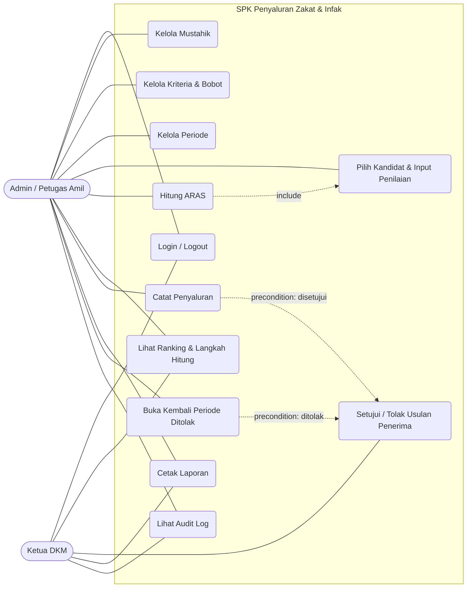
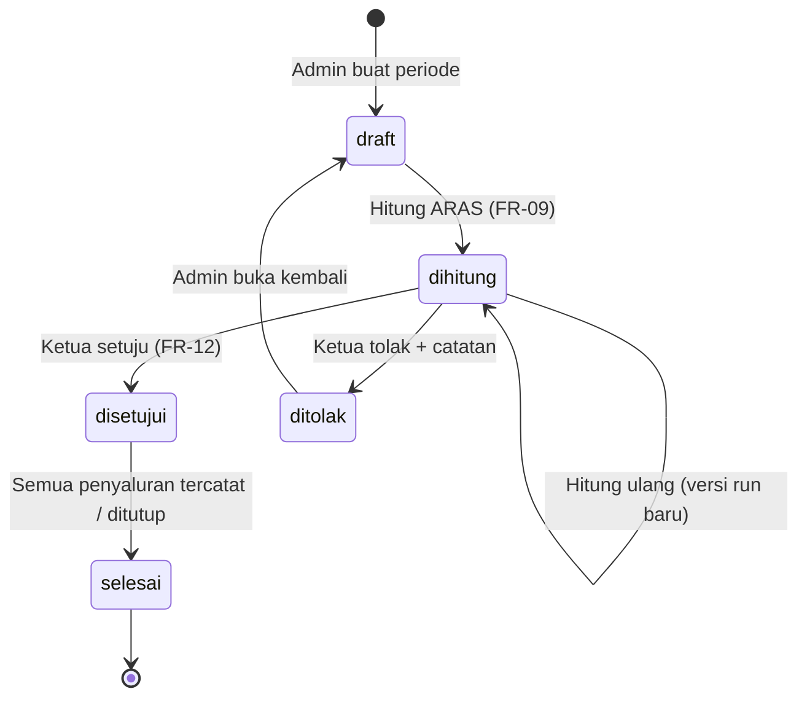
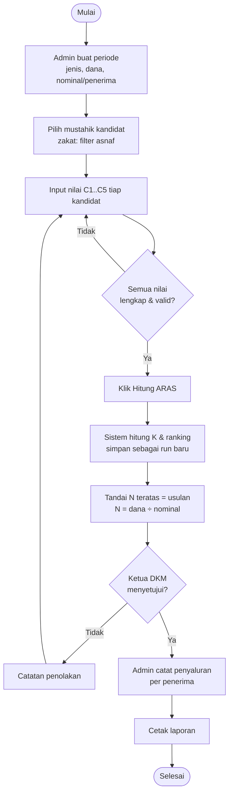
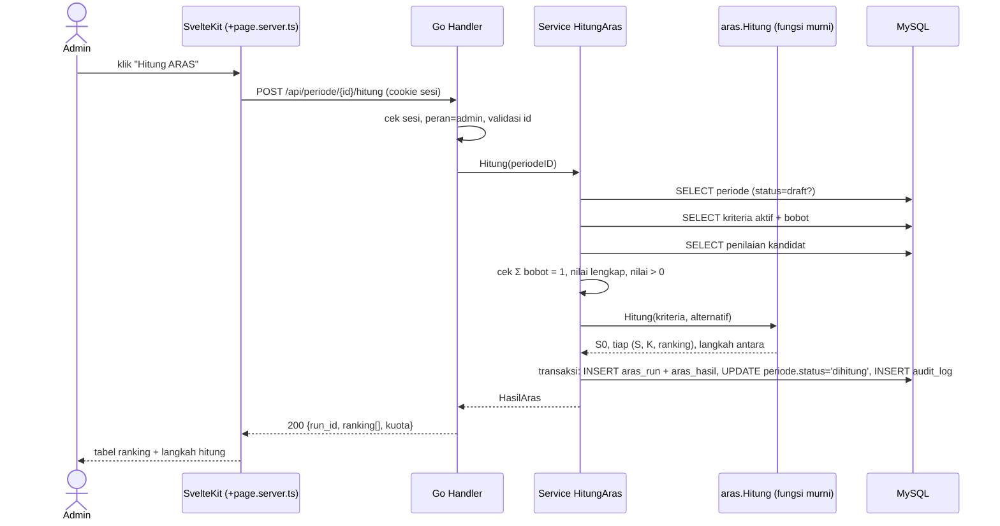
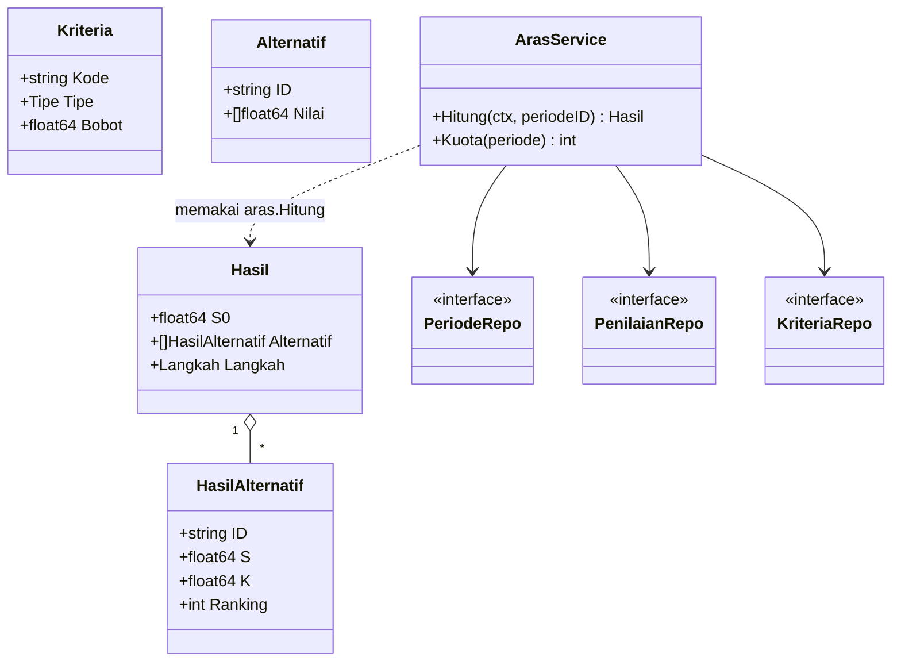
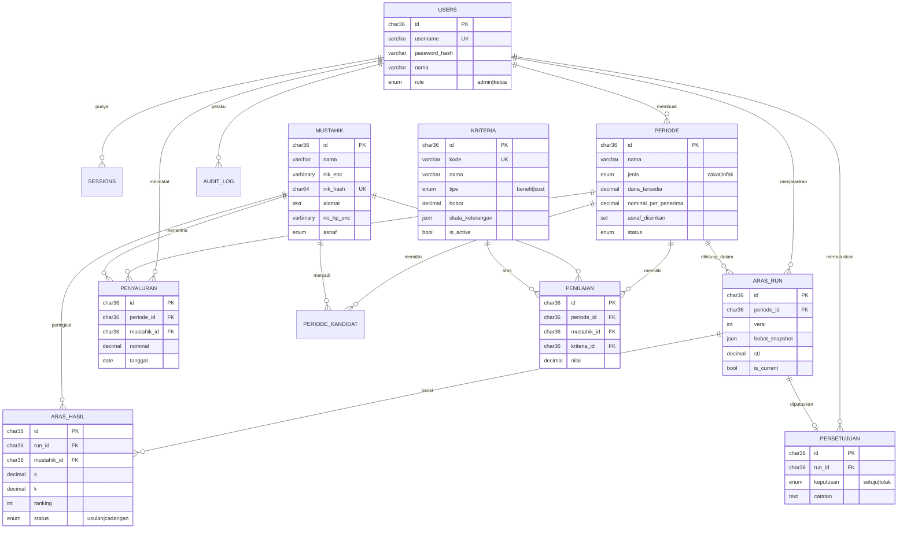

# 03 — Perancangan Sistem (UML + ERD)

Semua diagram memakai Mermaid (render otomatis di GitHub/VS Code/Obsidian; untuk skripsi ekspor ke PNG lewat <https://mermaid.live>).

## 1. Use Case Diagram
Mermaid tidak punya notasi use case bawaan, jadi dipakai flowchart: kotak = aktor, oval = use case.



## 2. Status Periode (State Diagram)

Aturan: nilai penilaian hanya bisa diubah saat `draft`; penyaluran hanya saat `disetujui` (FR-13).

## 3. Activity Diagram — Proses Penyaluran


## 4. Sequence Diagram — Hitung ARAS


## 5. Class Diagram (Backend Go)
Hanya struct inti; Go tidak punya class, digambar sebagai tipe + method.

Catatan: `Tipe` = `benefit | cost`; `Nilai` diurutkan sesuai urutan `Kriteria`; `Langkah` = matriks antara (normalisasi, terbobot) untuk ditampilkan di UI. Interface repo dipakai agar `ArasService` bisa di-unit-test dengan mock (rules global: unit test fokus ke service, repo diuji integrasi ke MySQL asli). `aras.Hitung` murni (tanpa I/O) → test table-driven memakai contoh dokumen 02.

## 6. ERD


## 7. Skema Tabel (MySQL 8, InnoDB, utf8mb4)
> **Sudah diimplementasikan** sebagai [`backend/migrations/V001__initial_schema.sql`](../backend/migrations/V001__initial_schema.sql) (skema) dan `V002__seed_kriteria.sql` (5 kriteria awal), dan terverifikasi di MySQL 8.0 asli. Bila ada selisih antara blok di bawah dan file migrasi, **file migrasi yang berlaku**. Perbedaan yang sengaja: komentar `audit_logs.action` diperpendek, dan ID dibuat oleh aplikasi (UUID v4) walau kolom tetap punya `DEFAULT (UUID())`. `V003__aras_run_langkah.sql` menambah kolom `aras_run.langkah JSON NULL` (langkah hitung tiap run: A0, matriks, normalisasi, terbobot) agar "Lihat langkah hitung" tetap bisa menampilkan run lama; kolom ini belum ada di blok di bawah. Perubahan skema berikutnya harus lewat file migrasi baru (`V004__…`), bukan mengedit blok di bawah.

Konvensi mengikuti `db-patterns.md`: snake_case plural, PK UUID, `created_at/updated_at/deleted_at` (soft delete), migrasi versioned (`V001__...sql`, tidak diedit setelah deploy).

```sql
-- V001__initial_schema.sql
CREATE TABLE users (
  id            CHAR(36)     NOT NULL DEFAULT (UUID()) PRIMARY KEY,
  username      VARCHAR(50)  NOT NULL,
  password_hash VARCHAR(255) NOT NULL,              -- Argon2id
  nama          VARCHAR(100) NOT NULL,
  role          ENUM('admin','ketua') NOT NULL,
  is_active     BOOLEAN      NOT NULL DEFAULT TRUE,
  created_at    DATETIME(3)  NOT NULL DEFAULT CURRENT_TIMESTAMP(3),
  updated_at    DATETIME(3)  NOT NULL DEFAULT CURRENT_TIMESTAMP(3) ON UPDATE CURRENT_TIMESTAMP(3),
  deleted_at    DATETIME(3)  NULL,
  UNIQUE KEY uq_users_username (username)
);

CREATE TABLE sessions (                              -- sesi di DB agar logout benar-benar mencabut sesi
  id          CHAR(36)    NOT NULL DEFAULT (UUID()) PRIMARY KEY,
  user_id     CHAR(36)    NOT NULL,
  token_hash  CHAR(64)    NOT NULL,                  -- hash token, bukan plaintext
  expires_at  DATETIME(3) NOT NULL,
  created_at  DATETIME(3) NOT NULL DEFAULT CURRENT_TIMESTAMP(3),
  UNIQUE KEY uq_sessions_token_hash (token_hash),
  KEY idx_sessions_user_id (user_id),
  CONSTRAINT fk_sessions_user FOREIGN KEY (user_id) REFERENCES users(id) ON DELETE CASCADE
);

CREATE TABLE mustahik (
  id         CHAR(36)     NOT NULL DEFAULT (UUID()) PRIMARY KEY,
  nama       VARCHAR(100) NOT NULL,
  nik_enc    VARBINARY(255) NOT NULL,                -- AES-256-GCM di app layer (PII, UU PDP)
  nik_hash   CHAR(64)     NOT NULL,                  -- HMAC-SHA256 untuk cek duplikat
  alamat     TEXT         NOT NULL,
  no_hp_enc  VARBINARY(255) NULL,
  asnaf      ENUM('fakir','miskin','amil','muallaf','riqab','gharim','fisabilillah','ibnu_sabil') NOT NULL,
  is_active  BOOLEAN      NOT NULL DEFAULT TRUE,
  created_at DATETIME(3)  NOT NULL DEFAULT CURRENT_TIMESTAMP(3),
  updated_at DATETIME(3)  NOT NULL DEFAULT CURRENT_TIMESTAMP(3) ON UPDATE CURRENT_TIMESTAMP(3),
  deleted_at DATETIME(3)  NULL,
  UNIQUE KEY uq_mustahik_nik_hash (nik_hash)
);

CREATE TABLE kriteria (
  id               CHAR(36)     NOT NULL DEFAULT (UUID()) PRIMARY KEY,
  kode             VARCHAR(10)  NOT NULL,
  nama             VARCHAR(100) NOT NULL,
  tipe             ENUM('benefit','cost') NOT NULL,
  bobot            DECIMAL(5,4) NOT NULL CHECK (bobot > 0 AND bobot <= 1),
  skala_keterangan JSON         NULL,                -- {"1":"layak milik sendiri", ...}
  urutan           TINYINT      NOT NULL,
  is_active        BOOLEAN      NOT NULL DEFAULT TRUE,
  created_at       DATETIME(3)  NOT NULL DEFAULT CURRENT_TIMESTAMP(3),
  updated_at       DATETIME(3)  NOT NULL DEFAULT CURRENT_TIMESTAMP(3) ON UPDATE CURRENT_TIMESTAMP(3),
  deleted_at       DATETIME(3)  NULL,
  UNIQUE KEY uq_kriteria_kode (kode)
);

CREATE TABLE periode (
  id                   CHAR(36)      NOT NULL DEFAULT (UUID()) PRIMARY KEY,
  nama                 VARCHAR(100)  NOT NULL,
  jenis                ENUM('zakat','infak') NOT NULL,
  dana_tersedia        DECIMAL(15,2) NOT NULL CHECK (dana_tersedia > 0),
  nominal_per_penerima DECIMAL(15,2) NOT NULL CHECK (nominal_per_penerima > 0),
  asnaf_diizinkan      SET('fakir','miskin','amil','muallaf','riqab','gharim','fisabilillah','ibnu_sabil') NULL,
  status               ENUM('draft','dihitung','disetujui','ditolak','selesai') NOT NULL DEFAULT 'draft',
  created_by           CHAR(36)      NOT NULL,
  created_at           DATETIME(3)   NOT NULL DEFAULT CURRENT_TIMESTAMP(3),
  updated_at           DATETIME(3)   NOT NULL DEFAULT CURRENT_TIMESTAMP(3) ON UPDATE CURRENT_TIMESTAMP(3),
  deleted_at           DATETIME(3)   NULL,
  KEY idx_periode_status (status),
  CONSTRAINT fk_periode_user FOREIGN KEY (created_by) REFERENCES users(id)
);

CREATE TABLE periode_kandidat (
  periode_id  CHAR(36) NOT NULL,
  mustahik_id CHAR(36) NOT NULL,
  PRIMARY KEY (periode_id, mustahik_id),
  CONSTRAINT fk_pk_periode  FOREIGN KEY (periode_id)  REFERENCES periode(id)  ON DELETE CASCADE,
  CONSTRAINT fk_pk_mustahik FOREIGN KEY (mustahik_id) REFERENCES mustahik(id)
);

CREATE TABLE penilaian (
  id          CHAR(36)      NOT NULL DEFAULT (UUID()) PRIMARY KEY,
  periode_id  CHAR(36)      NOT NULL,
  mustahik_id CHAR(36)      NOT NULL,
  kriteria_id CHAR(36)      NOT NULL,
  nilai       DECIMAL(15,4) NOT NULL CHECK (nilai > 0),   -- cost dipakai sebagai 1/x
  created_at  DATETIME(3)   NOT NULL DEFAULT CURRENT_TIMESTAMP(3),
  updated_at  DATETIME(3)   NOT NULL DEFAULT CURRENT_TIMESTAMP(3) ON UPDATE CURRENT_TIMESTAMP(3),
  UNIQUE KEY uq_penilaian (periode_id, mustahik_id, kriteria_id),
  CONSTRAINT fk_penilaian_kandidat FOREIGN KEY (periode_id, mustahik_id)
    REFERENCES periode_kandidat(periode_id, mustahik_id) ON DELETE CASCADE,
  CONSTRAINT fk_penilaian_kriteria FOREIGN KEY (kriteria_id) REFERENCES kriteria(id)
);

CREATE TABLE aras_run (                               -- tiap "Hitung ARAS" = 1 run; riwayat tidak dihapus
  id              CHAR(36)     NOT NULL DEFAULT (UUID()) PRIMARY KEY,
  periode_id      CHAR(36)     NOT NULL,
  versi           INT          NOT NULL,
  bobot_snapshot  JSON         NOT NULL,              -- bobot & tipe saat dihitung → hasil bisa direproduksi
  s0              DECIMAL(12,8) NOT NULL,
  is_current      BOOLEAN      NOT NULL DEFAULT TRUE,
  dijalankan_oleh CHAR(36)     NOT NULL,
  created_at      DATETIME(3)  NOT NULL DEFAULT CURRENT_TIMESTAMP(3),
  UNIQUE KEY uq_run_versi (periode_id, versi),
  CONSTRAINT fk_run_periode FOREIGN KEY (periode_id) REFERENCES periode(id),
  CONSTRAINT fk_run_user    FOREIGN KEY (dijalankan_oleh) REFERENCES users(id)
);

CREATE TABLE aras_hasil (
  id          CHAR(36)      NOT NULL DEFAULT (UUID()) PRIMARY KEY,
  run_id      CHAR(36)      NOT NULL,
  mustahik_id CHAR(36)      NOT NULL,
  s           DECIMAL(12,8) NOT NULL,
  k           DECIMAL(12,8) NOT NULL,
  ranking     INT           NOT NULL,
  status      ENUM('usulan','cadangan') NOT NULL,
  UNIQUE KEY uq_hasil_run_mustahik (run_id, mustahik_id),
  KEY idx_hasil_run_ranking (run_id, ranking),
  CONSTRAINT fk_hasil_run      FOREIGN KEY (run_id)      REFERENCES aras_run(id) ON DELETE CASCADE,
  CONSTRAINT fk_hasil_mustahik FOREIGN KEY (mustahik_id) REFERENCES mustahik(id)
);

CREATE TABLE persetujuan (
  id         CHAR(36)    NOT NULL DEFAULT (UUID()) PRIMARY KEY,
  run_id     CHAR(36)    NOT NULL,
  keputusan  ENUM('setuju','tolak') NOT NULL,
  catatan    TEXT        NULL,
  oleh       CHAR(36)    NOT NULL,
  created_at DATETIME(3) NOT NULL DEFAULT CURRENT_TIMESTAMP(3),
  UNIQUE KEY uq_persetujuan_run (run_id),
  CONSTRAINT fk_setuju_run  FOREIGN KEY (run_id) REFERENCES aras_run(id),
  CONSTRAINT fk_setuju_user FOREIGN KEY (oleh)   REFERENCES users(id)
);

CREATE TABLE penyaluran (
  id           CHAR(36)      NOT NULL DEFAULT (UUID()) PRIMARY KEY,
  periode_id   CHAR(36)      NOT NULL,
  mustahik_id  CHAR(36)      NOT NULL,
  nominal      DECIMAL(15,2) NOT NULL CHECK (nominal > 0),
  tanggal      DATE          NOT NULL,
  dicatat_oleh CHAR(36)      NOT NULL,
  created_at   DATETIME(3)   NOT NULL DEFAULT CURRENT_TIMESTAMP(3),
  UNIQUE KEY uq_penyaluran (periode_id, mustahik_id),   -- 1 penerima 1x per periode
  CONSTRAINT fk_salur_periode  FOREIGN KEY (periode_id)   REFERENCES periode(id),
  CONSTRAINT fk_salur_mustahik FOREIGN KEY (mustahik_id)  REFERENCES mustahik(id),
  CONSTRAINT fk_salur_user     FOREIGN KEY (dicatat_oleh) REFERENCES users(id)
);

CREATE TABLE audit_logs (
  id          CHAR(36)    NOT NULL DEFAULT (UUID()) PRIMARY KEY,
  actor_id    CHAR(36)    NULL,
  action      VARCHAR(30) NOT NULL,                  -- LOGIN|LOGIN_GAGAL|MUSTAHIK_*|KRITERIA_UBAH|PERIODE_BUAT|KANDIDAT|PENILAIAN|HITUNG|SETUJU|TOLAK|BUKA_KEMBALI|SALUR|TUTUP (dipetakan ke 5 kategori filter UI di dokumen 04)
  resource    VARCHAR(30) NOT NULL,
  resource_id CHAR(36)    NULL,
  detail      JSON        NULL,                      -- tanpa NIK/HP/password
  ip_address  VARCHAR(45) NULL,
  created_at  DATETIME(3) NOT NULL DEFAULT CURRENT_TIMESTAMP(3),
  KEY idx_audit_actor (actor_id),
  KEY idx_audit_resource (resource, resource_id),
  KEY idx_audit_created (created_at)
);
```

### Trade-off & catatan skema
- **UUID `CHAR(36)`** mengikuti konvensi global (mudah dibaca/di-debug). Ceiling: lebih boros index daripada `BINARY(16)`; untuk skala masjid (ratusan–ribuan baris) tidak terasa.
- **`bobot_snapshot` di `aras_run`**: bobot kriteria boleh berubah kapan saja, tetapi hasil lama tetap bisa dijelaskan/direproduksi (penting untuk akuntabilitas & pembuktian di sidang).
- **NIK/HP terenkripsi** + `nik_hash` untuk deteksi duplikat tanpa membuka plaintext (UU PDP No. 27/2022). Kunci enkripsi dari env var, bukan di repo.
- MySQL tidak mendukung partial index → filter `deleted_at IS NULL` tetap ditulis di query; index biasa cukup untuk skala ini.
- Validasi Σ bobot = 1 dilakukan di service (CHECK lintas baris tidak bisa di MySQL).

Lanjut: [04 — Rancangan UI & Arsitektur](04-rancangan-ui-arsitektur.md).
