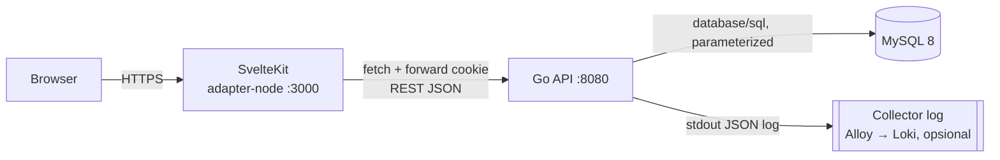

# 04 — Rancangan UI & Arsitektur

## 1. Keputusan Arsitektur
**Monolith sederhana, dua proses**: backend Go (REST JSON) + frontend SvelteKit (SSR), satu database MySQL.

| Pilihan | Alasan | Ditolak |
|---------|--------|---------|
| Monolith | 1 masjid, ≤ 500 mustahik, 2 peran, 1 tim (mahasiswa) — tidak ada sinyal untuk microservices/CQRS/Hexagonal (lihat `architecture-principles.md`) | Microservices, CQRS, Event-driven |
| Go + `chi` + `sqlx` + `database/sql` MySQL driver | Ringan, type-safe, query parameterized eksplisit | ORM (GORM) — query ranking/laporan lebih jelas ditulis SQL langsung |
| SvelteKit (Svelte 5) dengan *server load* + *form actions* | Cookie sesi dibaca di server, tidak ada token di JS browser; progressive enhancement | SPA murni dengan token di localStorage (rawan XSS) |
| Sesi cookie opaque di tabel `sessions` | Logout benar-benar mencabut sesi (OWASP A07) | JWT — overkill untuk 1 backend + 1 frontend |
| OpenTelemetry | **Tidak dipasang**: monolith → opsional. Baseline: `request_id` + `X-Request-Id` + log JSON | — |


Browser hanya bicara ke SvelteKit; Go API tidak diekspos publik (cukup jaringan internal/reverse proxy) → CORS tidak perlu dilonggarkan.

## 2. Struktur Folder (rencana)
```
App/
├── docs/                         ← dokumen rancangan ini
├── Design/                       ← mockup UI (HTML, PDF, PNG desktop/tablet/Android) = acuan visual
├── backend/                      ← Go
│   ├── cmd/server/main.go        ← entry point + perangkaian dependency
│   ├── cmd/useradmin/main.go     ← CLI buat user & reset password (FR-17)
│   ├── internal/
│   │   ├── aras/                 ← fungsi murni Hitung() + aras_test.go (fixture dokumen 02)
│   │   ├── config/               ← baca env var
│   │   ├── domain/               ← tipe + error terketik (Kriteria, Periode, ErrNotFound, ...)
│   │   ├── service/              ← logika bisnis: auth, mustahik, periode, hitung, penyaluran, laporan
│   │   ├── store/                ← repository MySQL (sqlx) + integration test
│   │   ├── http/                 ← router chi, handler, middleware (request_id, auth, rbac, recover, log)
│   │   └── crypto/               ← Argon2id, AES-GCM (NIK/HP), HMAC (nik_hash)
│   ├── migrations/               ← V001__initial_schema.sql, ...
│   └── go.mod
├── frontend/                     ← SvelteKit
│   ├── src/
│   │   ├── hooks.server.ts       ← baca cookie → panggil /api/auth/me → event.locals.user
│   │   ├── lib/server/api.ts     ← fetch wrapper ke Go (forward cookie, tangkap error)
│   │   ├── lib/components/       ← Tabel, FormField, Badge, KonfirmasiDialog
│   │   └── routes/               ← lihat peta halaman
│   └── package.json
├── .env.example
├── how-to-run.md                 ← dibuat saat kode ada
└── ARCHITECTURE.md               ← dibuat saat kode ada
```
Alur paket Go: `http → service → store`; `service` memanggil `aras` (murni). `domain` tidak mengimpor paket lain. Ini cukup satu lapis `service` — tanpa interface untuk hal yang hanya punya satu implementasi, **kecuali** repo (`store`) yang memang di-mock untuk unit test service.

## 3. Peta Halaman & Hak Akses
Acuan visual: folder `App/Design/` (`SPK Zakat ARAS — UI.html`, `.pdf`, dan `SPK Zakat ARAS — UI-png/`). Tiap layar tersedia dalam 3 ukuran: desktop (tanpa awalan), `Tablet · …`, `Android · …`. Dokumen ini tidak menyalin wireframe agar tidak basi; kalau desain berubah, ubah desainnya lalu perbarui tabel ini.

| Route | Halaman | File desain (desktop) | Admin | Ketua |
|-------|---------|-----------------------|:-----:|:-----:|
| `/` | Landing publik: profil masjid, transparansi dana (angka agregat dari `GET /api/publik/ringkasan`), jadwal salat, ringkasan penyaluran, kontak. *Desain awal memuat penjelasan metode; kini ada di `/cara-kerja`* | `Landing Page.png` | publik | publik |
| `/cara-kerja` | Penjelasan metode ARAS untuk awam: gagasan dasar, 5 kriteria + bobot, contoh hitung langkah demi langkah (statis, bukan data database), aturan tambahan, tanya jawab | – *(dibuat setelah desain)* | publik | publik |
| `/login` | Login + pesan error & sisa percobaan | `Login.png` | publik | publik |
| `/dashboard` | Kartu ringkasan penerimaan/penyaluran/saldo, jadwal salat, dana zakat dan infak, grafik 12 bulan, bagian **Penyaluran (metode ARAS)** (stepper 5 langkah, periode terbaru); *empty state* saat belum ada data. *Desain awal hanya 4 kartu penyaluran* | `Dashboard.png`, `Kosong 403 404.png` | ✓ | ✓ (tanpa "+ Buat periode") |
| `/mustahik` | Daftar + pencarian + chip Semua/Fakir/Miskin; tombol **Tambah** (di Android/tablet berbentuk tombol mengambang) | `Mustahik.png`, `Tablet · Mustahik.png`, `Android · Mustahik.png` | ✓ | – |
| `/mustahik/baru`, `/mustahik/[id]` | Form tambah / ubah mustahik: nama, NIK, asnaf, No. HP (opsional), alamat, kotak centang **Mustahik aktif**. Tablet & Android: **halaman penuh** (di Android dibuka dengan mengetuk baris daftar). Desktop: ditampilkan sebagai **panel samping** di sebelah daftar — route-nya sama, hanya layout yang berbeda | `Ubah Tambah Mustahik.png` *(belum ditinjau)*, `Tablet · Form Mustahik.png`, `Android · Form Mustahik.png` | ✓ | – |
| `/kriteria` | Ubah nama, tipe, bobot, skala, dan status aktif; tambah kriteria; indikator Σ bobot, tombol Kembalikan/Simpan | `Kriteria & Bobot.png` | ✓ ubah | lihat saja |
| `/periode` | Daftar + chip filter status (Semua/Draft/Dihitung/Disetujui/Ditolak/Selesai) | `Daftar Periode.png` | ✓ | lihat saja |
| `/periode/baru` | Form buat periode + kartu kuota & sisa dana langsung | `Buat Periode.png` | ✓ | – |
| `/periode/[id]` | Kepala (status, dana, nominal, kuota, asnaf) + 4 tab: **Kandidat**, **Penilaian**, **Hasil**, **Penyaluran** | `Periode — Kandidat.png`, `— Penilaian.png`, `— Hasil ARAS.png`, `— Penyaluran.png` | semua tab | tab Hasil + keputusan |
| `/periode/[id]` (ditolak) | Kartu "Usulan ditolak" + catatan Ketua + Buka kembali + Riwayat perhitungan | `Periode Ditolak (Admin).png` | ✓ | lihat |
| `/periode/[id]/laporan` | Laporan siap cetak + Unduh CSV | `Periode — Laporan.png` | ✓ | ✓ |
| `/audit` | Chip kategori + tabel hanya-baca (tablet/Android: daftar/linimasa) | `Audit Log.png`, `Tablet · Audit Log.png`, `Android · Audit Log.png` | ✓ | ✓ |
| `/laporan` | Daftar laporan = periode berstatus *selesai*; tiap baris membuka `/periode/[id]/laporan`. Android: menu Lainnya → Laporan; desktop/tablet: tautan "Laporan" di daftar Periode | `Android · Menu Lainnya.png` *(halaman daftarnya belum didesain)* | ✓ | ✓ |
| `/profil` | Profil & password: tampil nama, peran; form ganti password (lama, baru, ulangi). Desktop: lewat menu dropdown nama pengguna di kanan atas; Android: Lainnya → Profil & password | `Android · Menu Lainnya.png` *(halaman form belum didesain)* | ✓ | ✓ |
| `/tentang` | Tentang aplikasi: versi + ringkasan metode ARAS (statis) | `Android · Menu Lainnya.png` *(halaman belum didesain)* | ✓ | ✓ |
| `*` | Halaman **403** ("Akses tidak diizinkan. Halaman ini hanya untuk Admin. Anda masuk sebagai Ketua DKM.") dan **404** ("Halaman tidak ditemukan"), masing-masing dengan tombol kembali ke beranda | `Tablet · Kosong 403 404.png` (403), `Android · Kosong 403 404.png` (404); `Kosong 403 404.png` desktop = *empty state* "Belum ada data" | ✓ | ✓ |

Alur navigasi: `Landing → Login → Dashboard → Periode → [Kandidat → Penilaian → Hitung ARAS → Hasil] → (Ketua: Setujui/Tolak) → Penyaluran → Tutup → Laporan`. Bila ditolak: `Hasil (ditolak) → Buka kembali → Draft`.

## 4. Aturan Interaksi & Tampilan (dari desain)
- **Stepper dashboard** (`langkah_aktif` dihitung server): 1 Pilih kandidat (belum ada kandidat) → 2 Isi penilaian (ada sel kosong) → 3 Hitung ARAS (nilai lengkap, belum dihitung) → 4 Persetujuan Ketua (status `dihitung`) → 5 Penyaluran (status `disetujui`).
- **Penilaian**: tombol *Hitung ARAS* nonaktif sampai semua sel terisi; sel kosong bergaris merah + penghitung "Lengkap n/m kandidat"; C1 diisi 1 bila tidak berpenghasilan; legenda skala C3–C5 ditampilkan di bawah grid. Di Android: satu kartu per kandidat dengan tombol segmen 1–4 dan bilah aksi (Simpan / Hitung ARAS) menempel di bawah.
- **Kandidat**: daftar bercentang, hanya golongan asnaf yang diizinkan periode; ada "Kosongkan pilihan"; ringkasan "n dari m dipilih · kuota N".
- **Hasil**: tabel S, K, status USULAN/CADANGAN; ringkasan run (versi, tanggal, bobot, S₀); tombol "Lihat langkah hitung" membuka matriks ternormalisasi, terbobot, dan S. Panel keputusan (Setujui usulan / Tolak… dengan catatan wajib / Lihat laporan) hanya aktif untuk Ketua; Admin melihatnya read-only.
- **Penyaluran**: tiga kartu (penerima tercatat n/N, total tersalur, sisa dana); tiap baris punya tanggal + nominal (default = nominal per penerima) + tombol **Catat** sekali per penerima; **Tutup periode** aktif setelah semua penerima tercatat; cadangan ditampilkan sebagai keterangan, tidak disalurkan.
- **Format Indonesia (NFR-08)**: ribuan titik, desimal koma, tanggal `dd/mm/yyyy` — termasuk bobot di halaman Kriteria dan input tanggal Penyaluran (jangan memakai format bawaan browser `mm/dd/yyyy`, ambigu).
- **Tabel**: tinggi mengikuti isi (tanpa scrollbar internal yang memotong badge/baris); di layar sempit hanya scroll horizontal pada tabelnya.
- **Laporan**: `@media print` menyembunyikan sidebar & tombol; placeholder pada mockup (`[TANGGAL]`, `[NAMA ADMIN]`, `[NAMA KETUA DKM]`, `[ALAMAT MASJID]`, `[KONTAK]`) diisi dari data/konfigurasi (`.env`: nama & alamat masjid).
- **Login**: pesan generik "Username atau password salah. Sisa percobaan: n dari 5"; layar terkunci (429 + hitung mundur) dan sesi habis perlu ditambahkan ke desain.
- **Audit log**: kolom Waktu, Pengguna (nama), Aksi (badge), Objek, Keterangan; ada paginasi; footer menyatakan NIK/HP tidak pernah dicatat.
- **Mustahik tidak dihapus lewat UI**: desain tidak punya tombol Hapus; yang ada kotak centang "Mustahik aktif". Mustahik nonaktif tidak muncul di daftar kandidat baru, tetapi riwayat hasil & penyaluran lamanya tetap utuh. Kolom `deleted_at` tetap ada di skema untuk kebutuhan lain, tetapi tidak ada endpoint `DELETE`.
- **Akses per peran**: menu yang bukan untuk perannya **disembunyikan** (Ketua tidak melihat Mustahik; Kriteria dan Periode hanya-baca). Bila Ketua membuka URL halaman Admin langsung, backend membalas 403 dan UI menampilkan halaman 403. Catatan untuk desain: sidebar pada layar 403 saat ini masih menampilkan semua menu — perlu disesuaikan dengan menu Ketua.
- **Label menu**: pakai **"Beranda"** di semua ukuran layar (route tetap `/dashboard`); desain desktop yang menulis "Dashboard" perlu disamakan. Android: bottom nav Beranda · Mustahik · Periode · Lainnya (Lainnya = Kriteria & bobot, Audit log, Laporan, Profil & password, Tentang aplikasi, Keluar). Desktop/tablet: sidebar + dropdown pengguna (Profil & password, Keluar).
- **Input bobot (Kriteria)**: kelipatan 0,05 di semua ukuran layar. Android memakai tombol − / + (langkah 0,05); desktop/tablet boleh mengetik, divalidasi kelipatan 0,05. Di UI nilai disimpan sebagai persen bulat (5, 10, …) lalu dibagi 100 saat dikirim/ditampilkan; indikator "Total bobot" menandai pas/kurang/lebih. Tombol **Kembalikan** ada di semua ukuran (di Android belum digambar).
- **Layout grid Penilaian**: lebar ≥ desktop → tabel penuh tanpa scroll vertikal internal; tablet & Android → **kartu per kandidat** dengan tombol segmen 1–4 untuk C3–C5 (seperti mockup Android). Mockup tablet saat ini memotong kolom C5 dan baris A5 oleh scrollbar internal — harus diganti kartu atau tabel berscroll horizontal dengan kolom nama menempel.
- **Chip filter** (Periode, Audit, Mustahik) di layar sempit: boleh digeser, scrollbar bawaan disembunyikan (`scrollbar-width: none`) agar tidak menutupi teks chip.
- **Filter asnaf di Mustahik**: chip "Semua" + satu chip per golongan yang **punya data** (dinamis, jumlahnya dari `asnaf_counts`), bukan 3 chip tetap, karena golongan asnaf ada 8.
- **Laporan satu template**: tampilan layar boleh diringkas per ukuran, tetapi cetak/PDF/CSV selalu memakai template penuh di FR-14 (kop, A. kriteria & bobot, B. ranking dengan S dan K, C. realisasi + total, tanda tangan). Tombol: Unduh CSV dan Cetak/Simpan PDF (`window.print()`); tombol bagikan di Android memakai Web Share API bila tersedia.
- **Penyaluran**: Catat ditolak (422) bila total nominal tercatat melebihi dana tersedia; UI menampilkan sisa dana dan menonaktifkan Catat bila nominal > sisa.
- **Periode ditolak**: tombol "Lihat ranking run lama" tersedia di semua ukuran layar (mockup Android belum punya).
- Prinsip umum: label di atas input, pesan error `role="alert"`, aksi berbahaya lewat dialog konfirmasi, status selalu berupa teks + warna (tidak hanya warna).

## 5. Daftar Endpoint REST (Go API, prefix `/api`)
Semua endpoint kecuali login butuh cookie sesi; peran dicek di middleware (deny-by-default). Format error seragam: `{"error": "...", "request_id": "..."}`. Validasi input di handler/service; status: 400 bentuk salah, 401 tanpa sesi, 403 peran salah, 404, 409 konflik, 422 validasi bisnis.

| Method + Path | Peran | Validasi utama | Aksi / Query | Response sukses |
|---|---|---|---|---|
| `POST /auth/login` | publik | username & password wajib; 5 gagal/15 mnt per username+IP → terkunci | cari user (username tak ada pun menambah hitungan & dibalas sama), verifikasi Argon2id, insert `sessions`, set cookie | 200 `{user}`; 401 `{error, sisa_percobaan}`; 429 + `retry_after` bila terkunci |
| `GET /dashboard` | admin, ketua | – | hitung mustahik aktif per asnaf, periode berjalan, dana & total tersalur periode aktif, total tersalur semua periode (dipakai kartu bila tidak ada periode aktif), `langkah_aktif` (1–5), 5 periode terbaru | 200 |
| `POST /auth/logout` | semua | – | hapus baris `sessions` | 204 |
| `GET /auth/me` | semua | – | join sesi→user | 200 `{id,nama,role}` |
| `PUT /auth/password` | semua | password lama benar; baru ≥ 12 karakter & ≠ lama; rate limit sama dengan login | verifikasi Argon2id lama, hash baru, UPDATE `users`, hapus semua `sessions` user kecuali sesi saat ini + audit | 204; 422 bila lama salah/baru lemah |
| `GET /mustahik?q=&asnaf=&page=` | admin | page ≥ 1 | SELECT … `deleted_at IS NULL` + paging | 200 `{items,total,asnaf_counts}` |
| `POST /mustahik` | admin | nama 2–100; NIK 16 digit; asnaf ∈ enum; `aktif` (default true) | hash NIK → cek duplikat (409), enkripsi, INSERT | 201 `{id}` |
| `PUT /mustahik/{id}` | admin | sama, tetapi NIK/No. HP **kosong = tidak diubah**; `aktif=false` hanya bila mustahik tidak sedang jadi kandidat periode `dihitung`/`disetujui` (409) | UPDATE (menonaktifkan = `is_active=false`, bukan menghapus) | 200 |
| `GET /kriteria` | admin, ketua | – | SELECT aktif urut `urutan` | 200 `[kriteria]` + `total_bobot` |
| `PUT /kriteria/{id}` | admin | bobot kelipatan 0,05 (0,05–1,00); tipe ∈ enum; **Σ bobot aktif = 1** (422), dibandingkan sebagai persen bulat | UPDATE + audit | 200 |
| `GET /periode?status=`, `GET /periode/{id}` | admin, ketua | status ∈ enum | SELECT + hitung kuota | 200; detail memuat `runs[]` (riwayat) dan `catatan_penolakan` bila ditolak |
| `POST /periode` | admin | nama; jenis; dana > 0; nominal > 0; nominal ≤ dana | INSERT status `draft` | 201 `{id}` |
| `PUT /periode/{id}/kandidat` | admin | status `draft`; zakat → asnaf ∈ `asnaf_diizinkan` | replace isi `periode_kandidat` | 200 |
| `GET /periode/{id}/penilaian` | admin | – | matriks kandidat × kriteria | 200 |
| `PUT /periode/{id}/penilaian` | admin | status `draft`; kriteria berskala (C3–C5): hanya kunci skala (1–4); lainnya: 1 ≤ nilai ≤ 9.999.999.999 (penghasilan 0 → isi 1); boleh sebagian; satu sel salah membatalkan seluruh paket; pesan error per sel `nilai.<mustahikID>.<kode>` | upsert `penilaian` + audit | 200 |
| `POST /periode/{id}/hitung` | admin | status `draft`/`dihitung`; nilai lengkap; Σ bobot = 1 | `aras.Hitung`, transaksi insert `aras_run`+`aras_hasil`, status→`dihitung` | 200 `{run_id,ranking[],kuota}` |
| `GET /periode/{id}/hasil?run=` | admin, ketua | – | SELECT `aras_hasil` join mustahik (run saat ini default) | 200 + langkah hitung |
| `POST /periode/{id}/keputusan` | **ketua** | status `dihitung`; `keputusan` ∈ {setuju,tolak}; catatan wajib bila tolak | INSERT `persetujuan`, status→`disetujui`/`ditolak` + audit | 200 |
| `POST /periode/{id}/buka-kembali` | admin | status `ditolak` | status→`draft` | 200 |
| `POST /periode/{id}/penyaluran` | admin | status `disetujui`; mustahik ∈ usulan; nominal > 0; belum tercatat (409); Σ nominal tercatat + nominal ini ≤ `dana_tersedia` (422) | INSERT `penyaluran` + audit | 201 |
| `POST /periode/{id}/tutup` | admin | status `disetujui` | status→`selesai` | 200 |
| `GET /periode/{id}/laporan?format=json\|csv` | admin, ketua | – | gabung ranking, penerima, total tersalur | 200 |
| `GET /audit?kategori=&page=` | admin, ketua | kategori ∈ {login, data, hitung, keputusan, penyaluran}; page ≥ 1 | SELECT `audit_logs` join `users` (nama pelaku), filter `action` sesuai kategori, terbaru dulu | 200 `{items,total}` |
| `GET /healthz` | publik | – | `PING` ke MySQL | 200 `{ok:true}` |

Pemetaan kebutuhan → endpoint/halaman: FR-01/02 → auth; FR-03 → mustahik; FR-04/05 → kriteria; FR-06/07 → periode & kandidat; FR-08 → penilaian; FR-09/10/11 → hitung & hasil; FR-12 → keputusan; FR-13 → penyaluran; FR-14 → laporan; FR-15/20 → audit; FR-16 → landing (statis, tanpa endpoint); FR-17 → CLI `useradmin`; FR-18 → dashboard; FR-19 → detail periode + buka-kembali; FR-21 → `PUT /auth/password`; FR-22 → halaman statis `/tentang` dan `GET /periode?status=selesai` untuk daftar laporan.

Pemetaan `kategori` audit → `action`: login = LOGIN, LOGIN_GAGAL · data = MUSTAHIK_*, KRITERIA_UBAH, PERIODE_BUAT, KANDIDAT, PENILAIAN · hitung = HITUNG · keputusan = SETUJU, TOLAK, BUKA_KEMBALI · penyaluran = SALUR, TUTUP.

## 6. Keamanan & Logging (ringkas)
- Argon2id (memori 64 MB, 3 iterasi); cookie sesi `HttpOnly; Secure; SameSite=Strict`, kedaluwarsa 8 jam; token acak 32 byte, yang disimpan hanya hash SHA-256.
- Form action SvelteKit memakai proteksi CSRF bawaan (cek `Origin`); Go API menolak request tanpa cookie sesi valid.
- Header keamanan (CSP, `X-Content-Type-Options`, `X-Frame-Options: DENY`, HSTS) dipasang di `hooks.server.ts`.
- Query selalu parameterized; NIK/HP terenkripsi AES-256-GCM, kunci dari env var.
- `log/slog` handler JSON → stdout; field `request_id`, `method`, `path`, `status`, `duration_ms`, `user_id` (tanpa NIK/HP/password/token). `request_id` dari header `X-Request-Id` bila ada, jika tidak digenerate; dikembalikan di response dan di body error.
- Rate limit login per username + IP (5 gagal → kunci 15 menit); pesan error generik + `sisa_percobaan` dihitung juga untuk username yang tidak ada, supaya tidak bisa dipakai menebak akun. `ponytail:` penghitung di memori proses (hilang saat restart, hanya 1 instance) — pindah ke tabel `login_attempts` bila perlu multi-instance.
- Akun Ketua pertama dibuat lewat halaman `/setup` (hanya selama tabel `users` kosong, butuh kode sekali pakai dari log server). CLI `cmd/useradmin` (`buat --role admin|ketua`, `reset-password`; password dimasukkan interaktif, bukan argumen/log) tetap untuk pemulihan darurat. Akun berikutnya dikelola Ketua lewat halaman `/pengguna` (FR-17): buat, ubah nama/peran, nonaktifkan/aktifkan, reset password. Password tidak pernah masuk audit maupun log.
- Audit log untuk login (sukses & gagal), ubah bobot, hitung, keputusan, penyaluran, buka kembali, tutup.

## 7. Strategi Test (saat implementasi)
| Jenis | Cakupan |
|-------|---------|
| Smoke | Server start, `/healthz` 200, koneksi DB |
| Sanity | Hitung ARAS contoh dokumen 02 → K = 0,8939 / 0,7327 / 0,6888 / 0,5611 / 0,4099 (toleransi 1e-4); alur periode draft→dihitung→disetujui→penyaluran; Σ bobot persen bulat = 100; total penyaluran ≤ dana; ganti password mencabut sesi lain |
| Unit (table-driven) | `aras.Hitung` (benefit/cost, seri, 1 alternatif, nilai ≤ 0), kuota, validasi Σ bobot, transisi status |
| Integration | `store` ke MySQL asli (docker): unique NIK, FK kandidat→penilaian, transaksi hitung |
| Regression | Satu test baru tiap bug fix |

## 8. Urutan Implementasi yang Disarankan
1. `internal/aras` + test (inti skripsi, tanpa DB) → cocokkan dokumen 02.
2. Migrasi MySQL + `store` kriteria/mustahik/periode.
3. Auth (login, sesi, RBAC, penguncian) + CLI `useradmin` + middleware `request_id`/log.
4. Service periode → penilaian → hitung → keputusan → penyaluran → laporan.
5. Frontend: login → mustahik → kriteria → periode (tab-tab) → laporan.
6. Seed data contoh (5 alternatif dokumen 02) untuk demo sidang; `how-to-run.md` & `ARCHITECTURE.md`.
